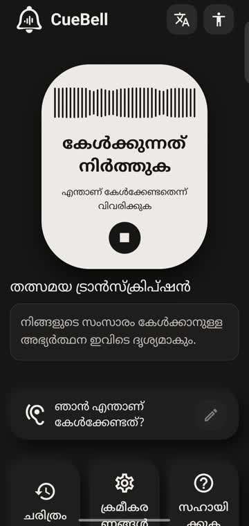

# CueBell

**Hear the announcement. See your turn.**

CueBell turns spoken announcements into personal visual alerts, with optional vibration and sound. It is built for people who are deaf or hard of hearing, starting with pharmacy token calls.

[Web app](https://cuebell.mathewjoseph.xyz) · [Android preview](https://github.com/mathew1046/CueBell/releases/tag/v1.4.1-preview) · [How to use CueBell](DEMO.md) · [Documentation](docs/README.md)

[**Medium story**](https://medium.com/@mathewjosephparakka/what-if-you-cant-hear-your-turn-the-story-behind-cuebell-3879d5a3a353): What If You Can’t Hear Your Turn?

## Demo video

[▶ Watch the demo](https://cuebell.mathewjoseph.xyz/demo/index.html) · [Download video](https://cuebell.mathewjoseph.xyz/demo/CueBell_demo_final.mp4)

## Example

1. Type or say: **“Tell me when pharmacy token 442 is called. Vibrate.”**
2. Accept processing and microphone permissions. A valid request starts listening automatically.
3. Hear: **“Token four four two, please go to counter two.”**
4. See the matching call and counter, with the requested alert.

Live captions show what was heard. Repeated calls are suppressed; recognized corrections update alerts. Names and transport announcements can also be described as tasks, without venue-system integration.

## Try it

- **Web:** keep the page visible and screen unlocked. Background listening is not supported.
- **Android:** the development-signed ARM64 preview requires Android 7+. Start capture while the app is visible; a foreground service can continue in the background. Device restrictions can interrupt capture or suppress alerts.

Use your own voice or consenting speakers. See the [use guide](DEMO.md) for setup, alerts and stopping.

## How it works

Microphone → optional local noise reduction → Gnani Prisma v3.0 → text interpretation → evidence checks → alert.

The shared React Native/Expo interface provides typed or spoken setup, captions, history and English plus 20 Indian UI languages. Translation coverage does not establish recognition quality. Android uses Kotlin capture; web uses AudioWorklet; a FastAPI relay keeps provider keys server-side.

**Audio goes to Gnani; requests and transcripts go to the configured OpenAI text fallback.** Evon is not integrated. The target is not a recognition hint. The app/relay do not save recording files or transcript databases; provider retention terms still apply. See [privacy](docs/PRIVACY.md) and [architecture](docs/ARCHITECTURE.md).

## Measured engineering results

- **42.2% lower setup delay:** median speech-end-to-confirmation fell from **10.75 s to 6.21 s**, six successful replays per arm, repeating two synthetic Hindi/Malayalam requests three times. Broader monitoring quality regressed, so this profile remains opt-in. [Pipeline results](docs/PIPELINE_OPTIMIZATION.md).
- **99.66% less transform scratch memory:** GTCRN transform tables/scratch fell from **4,210,688 to 14,336 bytes** while preserving tested output. This is not total app memory. [Methods](docs/NOISE_REDUCTION.md).
- **11/16 → 16/16 fully enhanced clips** after overload-handling changes. Estimated background quality improved on all 16 recorded-noise clips, but recognition did not consistently improve. Noise reduction stays off by default. [Results](docs/NOISE_REDUCTION.md).

These controlled experiments do not establish fewer missed turns or representative-user usability. See [verification](docs/VERIFICATION.md) and the [field-evaluation plan](docs/IMPACT.md).

## Limits

CueBell is a supplemental aid, not an official queue system or emergency alarm. Noise, recognition errors, nearby speech and network gaps can cause missed or false alerts. Check the venue display or staff. There is no offline recognition, queue prediction or speaker identification.

## Develop

[Backend](backend/README.md) · [Android](mobile/README.md) · [Web](docs/WEB.md) · [Contributing](CONTRIBUTING.md) · [Security](SECURITY.md)

## Team

**Mathew Joseph:** backend, speech/AI, Android service, languages, testing, deployment and releases.

**Devadathan M R:** interface, navigation, captions, waveform, spoken alerts, accessibility controls and branding.

## License

No project-wide license is selected. Public source does not grant reuse rights. Third-party licenses still apply.
